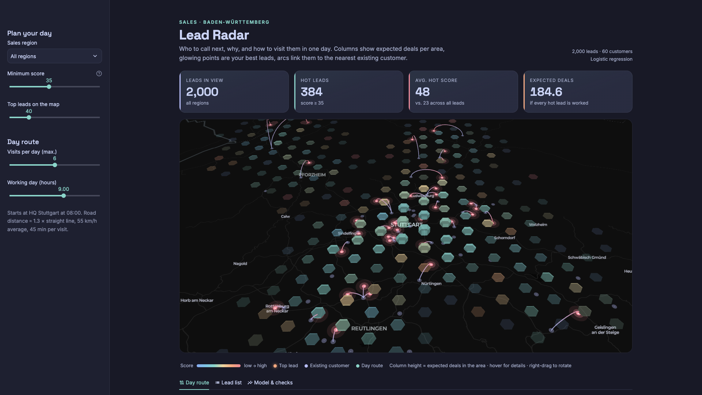

# Lead Radar · Stuttgart lead scoring



A demo from the keynote "AI workflows, agents and the skills they require" at the HdM International Week 2026 (Stuttgart Media University).
An AI coding agent (Claude Code) built this app from a single prompt. A human then checked the map in a browser, found problems, and a second agent run fixed them.

Lead-scoring app for the sales team of a fictional B2B software company in Stuttgart.
It scores ~2,000 CRM leads across 12 sales regions in Baden-Württemberg, explains every score
in plain language, shows everything on a 3D map and plans a day route through the best leads.

**All data is synthetic** (`data/`, generated by `scripts/make_data.py`). No real companies or people.

## Requirements

- [uv](https://docs.astral.sh/uv/) (it installs the right Python version for you)
- A modern browser; the map loads its dark basemap from Carto, so you need an internet connection

## Install and run

```bash
git clone https://github.com/kirenz/stuttgart-lead-scoring.git
cd stuttgart-lead-scoring
uv sync
uv run streamlit run app.py
```

The app opens at http://localhost:8501. On first start it trains the model (about 30 seconds) if `artifacts/` is missing.
To train and write the report yourself:

```bash
uv run train.py                 # model comparison, checks, scores -> artifacts/, reports/model_report.md
```

To regenerate the synthetic data (this changes all numbers):

```bash
uv run scripts/make_data.py
```

## Learning task: two traps in the data

The data contains two traps on purpose. Before you read the "Checks" section below, try to find them yourself:

1. One column almost gives away the outcome. Which one, and why must it not be a model input?
2. One region looks like the best market. Why should you not believe it?

## What is inside

| Path | Content |
|---|---|
| `train.py` | Leakage and region checks, model comparison, final model, scores and reasons |
| `app.py` | Streamlit app: KPI cards, hero map, day route, lead list, model and checks |
| `lead_scoring/model.py` | Features, models, lift, explanations and reason texts |
| `lead_scoring/geo.py` | Distances, nearest customer, day-route planner (nearest neighbour + 2-opt) |
| `lead_scoring/mapview.py` | pydeck map: H3 columns, glowing top leads, arcs, route, fly-in |
| `lead_scoring/theme.py` | Colours, CSS, Plotly template |
| `.streamlit/config.toml` | Dark custom theme |
| `reports/model_report.md` | Generated report of the last training run |
| `scripts/make_data.py` | Generates the synthetic leads and customers |
| `docs/screenshot.png` | Screenshot for this README |

## Model

- Features: company size, industry, source, website visits, demo requested, distance to the nearest customer.
- Compared on a stratified 25 % hold-out (500 leads) and 5-fold CV: logistic regression vs. gradient boosting
  (`HistGradientBoostingClassifier`), plus a rule of thumb (demo requested first, then most website visits).
- Gradient boosting is only chosen if it beats logistic regression by more than 0.01 CV ROC-AUC.
  In the current run logistic regression wins (CV ROC-AUC 0.718 vs. 0.688).
- Scores in the app are out-of-fold: every lead is scored by a model that did not see it.
- Reasons: per lead, the three features with the largest effect on the log-odds compared with typical leads.
  For logistic regression this is exactly coefficient × (value − average).

## Checks

- **Leakage:** `deal_stage` alone predicts the outcome with ROC-AUC 0.997 (Contract and Negotiation = 100 %
  converted, First contact, Qualified and Lost = 0 %). With it, the CV ROC-AUC jumps to 0.999. It is set late
  in the sales cycle, so it is excluded from the model and the app. All other columns stay below 0.63.
- **Small regions:** Ulm has only 9 leads (7 won, 78 %, 95 % interval 45 % to 94 %). Regions below 50 leads are
  flagged in the app. Region is not a model feature (adding it does not improve CV ROC-AUC).
- **Lift:** the honest result is in `reports/model_report.md`. In the top 10 % the model is about level with the
  rule of thumb (2.3× to 2.4× the base rate), because demo requesters are already a strong signal. The model's
  advantage is the ranking beyond that: ROC-AUC 0.70 vs. 0.64; calling the top 50 % finds 67 % of deals
  instead of 61 % (test set).

## Day route

Pick a region and a minimum score. The planner takes the best leads (up to the visit limit), orders them as a
round trip from HQ Stuttgart (nearest neighbour, then 2-opt) and drops the weakest lead until the day fits.
Assumptions: road distance ≈ 1.3 × straight line, 55 km/h average, 45 minutes per visit, start 08:00.

## License

MIT, see [LICENSE](LICENSE).
